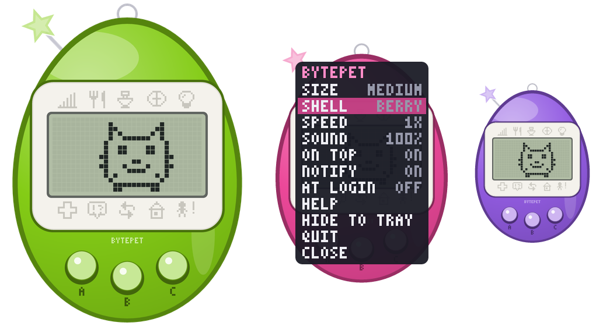

# Bytepet

A virtual pet that lives on your desktop: a small see-through handheld you can drag
anywhere, on Windows, macOS and Linux. It plays like a mid-2000s "Connection-era"
handheld, modelled on the V4.5 feature set. You raise one pet at a time along three
skill paths, with school, careers, mail, marriage across generations, and linking
between devices, which happens over your LAN instead of infrared.

All characters, names and art are original. This is a fan-made homage to that style of
gameplay. It is not affiliated with Bandai or the Tamagotchi brand.



## Install

Download the build for your OS from the latest GitHub release, or from the newest run of
the **build** workflow under *Actions → Artifacts*.

| OS | File | How |
|---|---|---|
| Windows 10/11 | `bytepet-…-windows-x86_64.zip` | Unzip and run `bytepet.exe`. If SmartScreen warns about an unrecognised app, choose *More info → Run anyway*. |
| macOS 11+ (Intel and Apple Silicon) | `bytepet-…-macos-universal.zip` | Unzip and move `Bytepet.app` to Applications. The first time, right-click it and choose *Open*. The app is ad-hoc signed, not notarized. |
| Linux x86_64 | `bytepet-…-linux-x86_64.tar.gz` | Extract it and run `./install.sh`, which installs to `~/.local` with a menu entry. You can also run `./bytepet` directly. |

The program is a single file of about 8 MB with no runtime to install. On Linux it needs
glibc 2.35 or newer (Ubuntu 22.04, Debian 12, Fedora 36 and later) plus the usual
desktop libraries (X11 or Wayland, OpenGL, ALSA or PipeWire).

## On your desktop

Bytepet opens as a floating, egg-shaped device in the bottom-right corner with no window
frame. Clicks on the empty space around the egg pass through to whatever is behind it.

- **Drag** the shell to move it. Bytepet remembers where you left it.
- **Right-click** it on the home screen for the settings menu: size (Small, Medium, Large or
  Huge), shell design (8), time speed, sound (off, or 25 to 100% volume), always on top,
  notifications, launch at login, help, hide and quit. Click a row to change it; the menu grows
  and shrinks with the device.
- **Tray or menu-bar icon:** click it to show or hide the pet, or right-click it for the same
  settings as a system menu, plus help and quit. On Windows and macOS,
  Bytepet has no taskbar or Dock button, so the tray icon is how you bring it back after
  hiding it.
- **Notifications:** you get a system notification when your pet calls, gets sick, hatches,
  grows up, gets mail or leaves, at most once every 2 minutes per kind.
- **Launch at login** adds Bytepet to your startup items: the registry Run key on
  Windows, a LaunchAgent on macOS, or an XDG autostart entry on Linux. Turn it off in the
  menu to remove it.
- **Starting Bytepet again** while it's running brings the running pet forward rather than opening
  a second copy. Each save file allows one copy, so `--save a.json` and `--save b.json` can run
  side by side.
- `--windowed` runs Bytepet as an ordinary framed window instead of the widget.

Keys work while Bytepet has focus, so click it first.

### Linux notes

- **Wayland** doesn't let apps keep themselves on top, choose where they open or let clicks
  pass through. When XWayland is available (`DISPLAY` is set), Bytepet runs through it so
  those features work. Set `BYTEPET_NATIVE_WAYLAND=1` to use native Wayland instead,
  which drops those three features.
- **GNOME** has no tray by default. Bytepet then shows in the taskbar instead.
  The *AppIndicator and KStatusNotifierItem Support* extension adds the tray icon.
  KDE, Xfce, Cinnamon and most other desktops show it out of the box.
- The see-through effect needs a compositing desktop, which covers any current GNOME,
  KDE, or Xfce with compositing turned on. Without one, the corners draw black.

## Controls

| Button | Keys | Meaning |
|---|---|---|
| A | `Z` `A` `J` `1` `←` | next / cycle |
| B | `X` `S` `K` `2` `↓` `Enter` `Space` | confirm (shows the clock on the main screen) |
| C | `C` `D` `L` `3` `→` `Esc` `Backspace` | back / cancel (calls the pet over on the main screen) |

Everything also works with the mouse alone:

| Mouse | Does |
|---|---|
| Click A, B or C | that button |
| Click an icon | opens it, even from inside another menu |
| Click the screen | B (choose) |
| Scroll wheel | A (next) |
| Right-click | C (back); on the home screen it opens the settings menu |
| Drag the shell or the screen | move Bytepet |

A+C together or `M` mutes. `F1` opens help, `F2` cycles time speed and `F3` cycles the shell
design. When the game asks for a name or an IP address, type it on your keyboard.

## How it plays

Time runs in real time and follows your computer's clock: the pet sleeps at night, local
time. Time also keeps running while Bytepet is closed, up to 14 days, which are
simulated the next time it starts. To pause instead, set *Town → Setup → WHEN OFF* to
PAUSE. Speeds of 10×, 60× and 600× are for trying things out.

| Stage | Length | Notes |
|---|---|---|
| Egg | 1 minute | Name your pet first |
| Baby | 1 hour | Needs constant care; care mistakes here choose between two children |
| Child | 1 day | Games, mail and school unlock |
| Teen | 2 days | The highest skill decides the path when it grows up |
| Adult | from day 3 | Jobs; the matchmaker from age 5 |
| Senior | age 8 if unmarried | Can only marry another senior, and that pairing produces a rare egg |

**Care.** Hunger and happiness are 4 hearts each. When either one empties, the pet calls with
the attention icon and a beep. A call left for 15 minutes counts as a care mistake. Clean up
poop, give medicine when the skull appears (some illnesses need two doses), and turn the
lights off once the pet falls asleep, or that counts as a care mistake too. A pet left sick or
starving for too long goes back to its home planet.

**Discipline.** Sometimes the pet calls when nothing is wrong, or refuses food: SCOLD it.
Sometimes it shows off with a little dance: PRAISE it. Getting these right fills the
training meter, and the best adult on each path needs a high one.

**Skills.** There are three: Humor, Gorgeous and Passion. CLIMB trains Humor, TUG trains
Gorgeous and APPLES trains Passion. MANHOLE earns Gotchi Points (GP). School letters let
you pick a teacher and sit a short quiz. Shop items and mail add more.

**Adults.** Each path has four adults, decided by care mistakes and discipline, plus a
secret adult for 200+ in that path's skill with zero care mistakes after the baby stage.
There are 23 characters in all.

**Jobs.** Job offers arrive by mail once a skill is high enough. Pass a short interview
quiz and WORK appears in the game menu, playable once every 2 hours. Office, Scientist,
Chef, Firefighter and Rock Star each have their own game.

**Town.** Mail, the shop (food, toys, a medkit), your items, the matchmaker, the friends
list, an album of past generations, and setup.

## Linking two Bytepets (the "IR" port)

Both computers must be on the same network.

1. On one, choose **LINK → HOST**.
2. On the other, choose **LINK → JOIN**, which finds hosts automatically, or **LINK → IP**
   and type the address shown on the host's screen.
3. Both screens show the same 4-digit code. If it matches, press **B on the host** to
   accept the link, or C to refuse it. Nothing is exchanged before that.
4. The host picks one of four actions:
   - **VISIT:** the pets meet and their friendship goes up.
   - **GAME:** EATS, FLAGS or BUMP. Both sides play the same seeded round and the scores are compared.
   - **GIFT:** send an item or 100 GP.
   - **MARRY:** needs SOULMATE friendship (10 link-ups) and two eligible adults, or two
     seniors. Both players get the next-generation egg.

Linking uses TCP port 41975 and UDP port 41976. Windows and macOS ask whether to allow
network access the first time you host: allow it on private networks. If 41975 is busy,
the host falls back to another port and shows it, for example `192.168.1.20:41980`, and
you type the address with the port. To try it on one computer, run two copies with
different saves: `bytepet --save a.json` and `bytepet --save b.json`.

Both sides need Bytepet 2.x. The 1.x Python version uses an older protocol: its hosts
don't appear under JOIN, and a link by IP stops with OTHER VERSION on the 2.x side.

## Saves

| OS | Location |
|---|---|
| Windows | `%APPDATA%\Bytepet\save.json` |
| macOS | `~/Library/Application Support/Bytepet/save.json` |
| Linux | `~/.local/share/bytepet/save.json` (or under `$XDG_DATA_HOME`) |

`bytepet --paths` prints the exact locations. The game saves every 20 seconds and on exit,
and writes the file in one step, so a crash can't leave it half-written. Widget position,
size and toggles live in the same file.

- **Coming from Bytepet 1.x (Python):** the save sits in the same place and is upgraded
  automatically the first time 2.x starts. Your pet, items, friends and album all carry over.
- **Damaged save:** the bad file is renamed to `save.json.corrupt` and a new egg starts.
- **Save from a newer version:** Bytepet plays it but never writes over it.

## Modding

Characters, sprites, item prices, timings, jobs, mail and friendship levels all live in
three text files.

```bash
bytepet --export-content <save folder>/content
```

This writes `characters.toml`, `props.toml` and `game.toml` into the content folder
next to your save. Edit them and restart Bytepet. Each file you leave in that folder
replaces the built-in version, and you can delete any file to go back to the default.
Every sprite is a 16×16 grid of `#` and `.`, and the comments at the top of each file
explain the format. If a modded file has a mistake, Bytepet uses the built-in content and
tells you what's wrong, both in a notification and on the terminal. Problems loading the
save are reported the same way.

`tools/preview_sprites.py` checks `characters.toml` and draws a contact sheet of every
frame.

## Command line

```
bytepet [--save FILE] [--speed 1|10|60|600] [--new] [--windowed]
        [--export-content DIR] [--screenshot FILE] [--paths] [--version] [--help]
```

`--new` ignores the existing save and starts a fresh egg; the old save is overwritten at
the next autosave. `--screenshot` renders the device to a PNG and exits without opening
a window.

## Building from source

You need Rust 1.80 or newer, from [rustup.rs](https://rustup.rs).

```bash
cargo build --release          # → target/release/bytepet(.exe)
cargo run --release            # build and run
```

On Linux you also need the ALSA headers: `sudo apt install libasound2-dev pkg-config` on
Debian and Ubuntu, or `sudo dnf install alsa-lib-devel` on Fedora. Everything else is
loaded at runtime.

The game core builds without any desktop dependencies:

```bash
cargo test --no-default-features                       # unit, flow, link and render tests
cargo test --no-default-features -- --ignored    # plus a long random-input fuzz
cargo run --example export_art --no-default-features -- art/   # every sprite, screen and game as PNG
```

`.github/workflows/build.yml` runs these tests on Windows, macOS and Linux, lints the
code, and builds the three packages: a Windows zip with the icon embedded, a universal
macOS `.app` and a Linux tarball. Push a tag such as `v2.0.0` to get a draft GitHub
release with all three attached.

## Project layout

```
content/          characters, props and game rules (TOML; embedded, overridable)
src/
  sim.rs          the pet simulation: timers, care, evolution, jobs, mail, marriage
  content.rs      loads and validates the content files
  screens/        every LCD screen (care, town, main) as a screen stack
  games/          13 mini-games: 4 regular, 5 jobs, quiz, 3 versus
  link.rs net.rs  the LINK menu and LAN networking (discovery, pairing, JSON over TCP)
  core.rs         ties sim + screens + input + saving together, no OS dependencies
  render.rs       draws the device (tiny-skia); layout.rs has its geometry and shells
  save.rs         versioned save files and migrations
  instance.rs     one running copy per save file
  overlay.rs      the right-click menu
  desktop/        window (winit + OpenGL), tray, notifications, sound, autostart,
                  click-through shape
tests/            end-to-end flows, two-device link tests, fuzzing, render checks
examples/         export_art: renders all art to PNG
packaging/        macOS Info.plist, Linux .desktop file and installer
```

## Known limitations

- **No code signing.** Windows SmartScreen and macOS Gatekeeper warn the first time you run it.
- **Windows notifications** are sent as "Bytepet" with its icon. For that, Bytepet registers itself
  under `HKCU\Software\Classes\AppUserModelId\Bytepet.Desktop` and keeps a copy of its icon in its
  save folder; delete both if you remove Bytepet. If registering fails, notifications fall back to
  showing as "Windows PowerShell".
- **Native Wayland:** no always-on-top, remembered position or click-through (see Linux notes).
- **macOS click-through** relies on the system passing clicks through fully transparent pixels.
