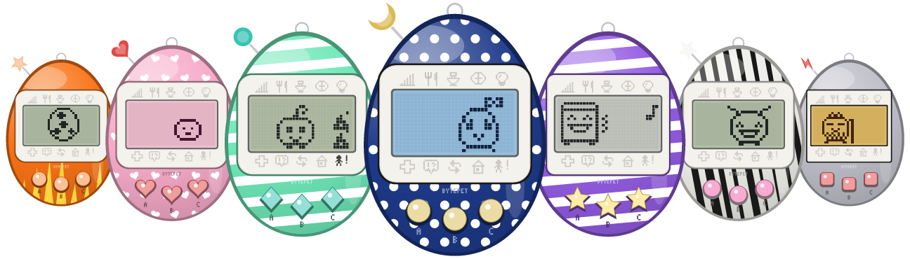
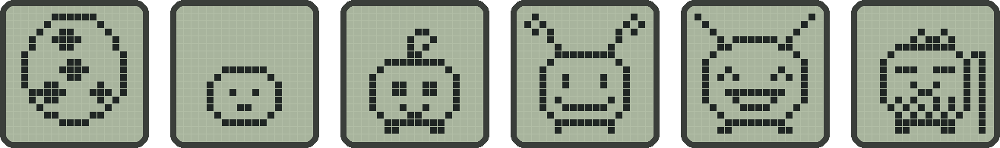
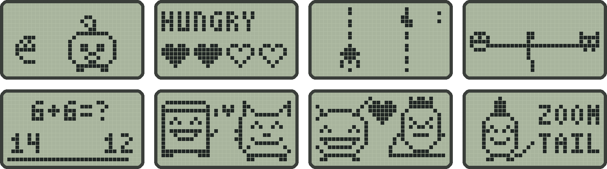
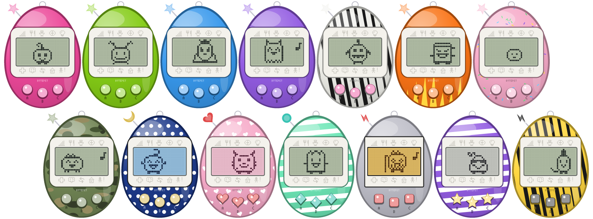

<div align="center">


**A pocket-sized virtual pet that lives on your desktop.**

Hatch it, feed it, raise it, marry it off and start the next generation,<br>
all on a little see-through handheld that sits in the corner of your screen.

[](https://github.com/Erdmann5150/Bytepet/releases/latest)
[](https://github.com/Erdmann5150/Bytepet/actions/workflows/build.yml)




[**Download**](#-get-bytepet) · [**How it plays**](#-how-it-plays) · [**Linking**](#-link-up-with-a-friend) · [**Controls**](#-controls) · [**Modding**](#-modding) · [**Building**](#-for-developers)

</div>

---

Bytepet plays like a mid-2000s "Connection-era" handheld, modelled on the V4.5 feature set.
You raise one pet at a time along three skill paths. Along the way there's school, jobs,
mail and marriage across generations, and you link with friends over your home network
instead of infrared.

- 🥚 **23 original characters**, from a wobbling egg to a creaky old senior
- 🕹️ **12 LCD mini-games** for training, jobs and head-to-head play
- 🏫 **School, careers and mail** that change as your pet grows
- 💞 **Link with friends on your LAN** to visit, play, trade gifts and get married
- 🎨 **12 preset shells**, a full customiser for every part of the device, and up to 9 saved themes
- 🪶 **One small program**: no installer needed, no account, nothing running in the cloud

> [!NOTE]
> All characters, names and art are original. Bytepet is a fan-made homage to that style of
> play. It is not affiliated with Bandai or the Tamagotchi brand.

## 📦 Get Bytepet

Grab the build for your computer from the **[latest release](https://github.com/Erdmann5150/Bytepet/releases/latest)**.

| OS | File | How |
|---|---|---|
| **Windows** 10/11 | `bytepet-…-windows-x86_64.zip` | Unzip and run `bytepet.exe`. If SmartScreen warns about an unrecognised app, choose *More info → Run anyway*. |
| **macOS** 11+ (Intel and Apple Silicon) | `bytepet-…-macos-universal.zip` | Unzip and move `Bytepet.app` to Applications. The first time, right-click it and choose *Open*. |
| **Linux** x86_64 | `bytepet-…-linux-x86_64.tar.gz` | Extract it and run `./install.sh`, which installs to `~/.local` with a menu entry. You can also run `./bytepet` directly. |

There's nothing else to install. On Linux it needs glibc 2.35 or newer (Ubuntu 22.04,
Debian 12, Fedora 36 and later). The builds aren't code-signed, which is why Windows and
macOS warn you the first time you run it.

📖 Every download includes the **[Player's Manual](https://github.com/Erdmann5150/Bytepet/releases/latest/download/Bytepet_Manual.pdf)**
and a two-page **[Quick Reference](https://github.com/Erdmann5150/Bytepet/releases/latest/download/Bytepet_Quick_Reference.pdf)**
card as PDFs. Those links always point to the newest versions.

<details>
<summary><b>Uninstalling</b></summary>

- **Windows:** delete the program folder. To show notifications as "Bytepet", it also
  registers `HKCU\Software\Classes\AppUserModelId\Bytepet.Desktop` and keeps
  `bytepet-icon.png` in the save folder, so delete those too.
- **macOS:** delete `Bytepet.app`.
- **Linux:** run `./install.sh --remove`.

Your save stays where it is (see [Saves](#-saves)). Delete it too if you want a clean slate.

</details>

## 🐣 How it plays

<div align="center">

<br><sub>Egg → <b>PIPI</b> → <b>PEBBIT</b> → <b>JESTLET</b> → <b>GRINKLE</b> → <b>OLDBEAN</b>: one of many ways a life can go</sub>
</div>

<br>

Time runs in real time and follows your computer's clock, so your pet sleeps at night. It
also keeps going while Bytepet is closed, for up to 14 days. To pause it instead, set
*Town → Setup → WHEN OFF* to PAUSE.

🌙 If you sleep by day, *Town → Setup → BEDTIME* moves your pet's whole day by up to 12 hours
either way: at +8H, a child that would sleep from 20:00 to 08:00 sleeps from 04:00 to 16:00.

| Stage | Length | What happens |
|---|---|---|
| 🥚 **Egg** | 1 minute | Name your pet first |
| 🍼 **Baby** | 1 hour | Needs constant care. Care mistakes here decide which of two children it becomes |
| 🎒 **Child** | 1 day | Games, mail, school and linking unlock |
| 🎧 **Teen** | 2 days | Its highest skill decides its path when it grows up |
| 💼 **Adult** | from day 3 | Jobs, and the matchmaker from age 5 |
| 👴 **Senior** | age 8 if unmarried | Can only marry another senior, and that pairing produces a rare egg |

**❤️ Care.** Hunger and happiness are 4 hearts each. When either runs out, your pet calls
with the attention icon and a beep, and a call left for 15 minutes counts as a care mistake.
Clean up poop, give medicine when the skull appears (some illnesses need two doses), and
turn the lights off once it falls asleep, or that's a care mistake too. A pet left sick or
starving for too long goes back to its home planet. The attention icon stays lit while
anything is waiting: a call, poop, a sickness, an empty heart, or the lights left on.

**📏 Discipline.** Sometimes your pet calls when nothing is wrong, or refuses food: SCOLD it.
Sometimes it shows off with a little dance: PRAISE it. Getting these right fills the
training meter, and the best adult on each path needs a high one.

**⭐ Skills.** There are three: **Humor**, **Gorgeous** and **Passion**. CLIMB trains Humor,
TUG trains Gorgeous and APPLES trains Passion. MANHOLE earns Gotchi Points (GP). School
letters let you pick a teacher and sit a short quiz, and shop items and mail add more.

**🌟 Adults.** Each path has four adults, decided by care mistakes and discipline. There's
also a secret adult for 200+ in that path's skill with zero care mistakes after the baby
stage.

**💼 Jobs.** Job offers arrive by mail once a skill is high enough. Pass a short interview
quiz and WORK appears in the game menu, playable once every 2 hours. **Office**,
**Scientist**, **Chef**, **Firefighter** and **Rock Star** each have their own game.

**🏘️ Town.** Mail, the shop (food, toys and a medkit), your items, PARTNER (the
matchmaker), the friends list, an album of past generations, and setup.

Speeds of 10×, 60× and 600× are there for trying things out. While one is on, a badge
above the screen shows it. The time speed never moves bedtime.

<div align="center">

<br><sub>Snack time, a hungry pet, CLIMB, TUG, a school quiz, a friend's visit, a wedding and growing up</sub>
</div>

## 💞 Link up with a friend

Both computers need to be on the same network.

1. On one, choose **LINK → HOST**.
2. On the other, choose **LINK → JOIN**, which finds hosts automatically, or **LINK → IP**
   and type the address shown on the host's screen.
3. Both screens show the same 4-digit code. If it matches, press **B on the host** to
   accept, or C to refuse. Nothing is exchanged before that.
4. You take turns, the host first. Whoever's turn it is picks one of four things to do, and
   when it's done the turn passes to the other side:

| Action | What happens |
|---|---|
| 👋 **VISIT** | The pets meet and their friendship goes up. |
| 🕹️ **GAME** | EATS, FLAGS or BUMP. Both sides play the same round and the scores are compared. |
| 🎁 **GIFT** | Send an item or 100 GP. |
| 💍 **MARRY** | Needs SOULMATE friendship (10 visits, games or gifts) and two eligible adults, or two seniors. Both players get the next-generation egg, and the link ends. |

Either side can leave with C. Both copies need to be up to date: linking with one from before
turn-taking shows OTHER VERSION.

<details>
<summary><b>Network details and troubleshooting</b></summary>

Linking uses TCP port 41975 and UDP port 41976. Windows and macOS ask whether to allow
network access the first time you host: allow it on private networks. If 41975 is busy,
the host uses another port and shows it, for example `192.168.1.20:41980`. Type the
address with the port.

To try linking on one computer, run two copies with different saves:
`bytepet --save a.json` and `bytepet --save b.json`.

</details>

## 🎨 Make it yours

<div align="center">

<br><sub>BERRY · LIME · OCEAN · GRAPE · ZEBRA · FLAME · DONUT · CAMO · COSMIC · SWEET · MINT · RETRO, then two of your own</sub>
</div>

<br>

The settings' **SHELL** page has 12 preset designs, plus pages for every part of the device:

- **Body:** colour, pattern, pattern colour and shine
- **Buttons:** colour, shape and letters
- **Antenna:** shape, colour and key ring
- **Screen:** faceplate, rim, frame, corners and LCD colour
- **Icons:** icon colour, the selected icon, the alert icon and the BYTEPET text

Each part changes as you watch, and **RANDOM** changes every part at once (asking first if
your design isn't saved). **THEMES** keeps up to 9 designs of your own: SAVE the one you're
wearing, then pick THEME 1, THEME 2 and so on to WEAR it again or DELETE it.

## 💻 On your desktop

Bytepet opens as a floating, egg-shaped device in the bottom-right corner. Clicks on the
empty space around the egg go through to whatever is behind it.

- **Drag** the shell to move it. Bytepet remembers where you left it.
- **Settings:** the everyday ones (speed, sound, shell, bedtime) are in Town > SETUP, and **MORE**
  there opens all of them: size, shell, time speed, sound volume, always on top,
  notifications, launch at login, help, hide and quit. They open on the device's own
  screen, which switches to a finer dot grid to show them, so the rest of the device stays
  in sight while you change it. Use the device's buttons: **A** for the next row, **B** to
  change or open it, **C** to go back. With the mouse, **scroll** to pick a row, **click**
  to change or open it and **right-click** to go back. On the keyboard, up and down move,
  and left and right change a setting either way.
- **Left alone,** a menu or the settings go back to the home screen after a minute, and a
  highlighted icon goes out after 30 seconds. Games, animations and links are never cut short.
- **Tray or menu-bar icon:** hover over it to see how your pet is doing (its hearts and what
  it needs), and click it to show or hide the pet. Its menu has *Show / hide*,
  *Settings* (brings the pet forward with its settings open) and *Quit*. On Windows and
  macOS Bytepet has no taskbar or Dock button, so the tray icon is how you bring it back
  after hiding it.
- **Notifications** tell you when your pet calls, gets sick, hatches, grows up, gets mail
  or leaves, at most once every 2 minutes for each kind.
- **Starting Bytepet again** brings the running pet forward instead of opening a second copy.
- `--windowed` runs it as an ordinary framed window instead.

<details>
<summary><b>Linux notes</b></summary>

- **Wayland:** Bytepet runs through XWayland automatically, so staying on top, the
  remembered position and click-through all work. Only without XWayland (or with
  `BYTEPET_NATIVE_WAYLAND=1`) do those three features go away, because Wayland doesn't let
  apps do them.
- **GNOME** has no tray icon unless the *AppIndicator and KStatusNotifierItem Support*
  extension is on (Ubuntu turns it on by default). Without it, Bytepet shows in the taskbar
  instead. KDE, Xfce, Cinnamon and most other desktops show the tray icon out of the box.
- The see-through corners need a compositing desktop. Without one, they draw black.

</details>

## 🎮 Controls

Keys work while Bytepet has focus, so click it first.

| Button | Keys | Does |
|:---:|---|---|
| **A** | `Z` `A` `J` `1` `←` | next / cycle |
| **B** | `X` `S` `K` `2` `↓` `Enter` `Space` | confirm (shows the clock on the main screen) |
| **C** | `C` `D` `L` `3` `→` `Esc` `Backspace` | back / cancel (clears the selected icon on the main screen) |

| Mouse | Does |
|---|---|
| Click A, B or C | presses that button |
| Click an icon | opens it, even from inside another menu |
| Click the screen | B |
| Scroll wheel | down for the next option (A), up for the previous one |
| Right-click | C: back, or clear the selected icon |
| Drag the shell or the screen | moves Bytepet |

**A+C** together or `M` mutes. `F1` opens help, `F2` cycles time speed and `F3` cycles the
preset shells. When the game asks for a name or an IP address, type it on your keyboard.

## 💾 Saves

| OS | Location |
|---|---|
| Windows | `%APPDATA%\Bytepet\save.json` |
| macOS | `~/Library/Application Support/Bytepet/save.json` |
| Linux | `~/.local/share/bytepet/save.json` (or under `$XDG_DATA_HOME`) |

`bytepet --paths` prints the exact locations. The game saves every 20 seconds and on exit.
Each save is flushed to disk before it replaces the last one, so neither a crash nor a power
cut can leave it half-written, and the save before it is kept as `save.json.bak`. If the save
is damaged, it's renamed to `save.json.corrupt` and Bytepet carries on from the backup (or,
without one, a new egg starts). A save from a newer version is played but never overwritten.

## 🧩 Modding

Characters, sprites, item prices, timings, jobs, mail and friendship levels all live in
three text files:

```bash
bytepet --export-content <save folder>/content
```

This writes `characters.toml`, `props.toml` and `game.toml` into a `content` folder next to
your save (`bytepet --paths` shows where). Edit them and restart Bytepet. To go back to the
built-in version of a file, delete it. Every sprite is a 16×16 grid of `#` and `.`, and the
comments at the top of each file explain the format. If a file has a mistake, Bytepet falls
back to the built-in content and tells you what's wrong.

## 📟 Command line

```
bytepet [--save FILE] [--speed 1|10|60|600] [--new] [--windowed]
        [--export-content DIR] [--screenshot FILE] [--paths] [--version] [--help]
```

`--new` starts a fresh egg, and the old save is overwritten at the next autosave.
`--screenshot` renders the device to a PNG and exits without opening a window.

## 🔧 For developers

Bytepet is written in Rust. The game core (simulation, screens, rendering, saves and
networking) has no OS dependencies. The desktop shell sits behind the default `desktop`
feature.

### Building from source

You need Rust 1.89 or newer from [rustup.rs](https://rustup.rs). On Linux you also need the
ALSA headers: `sudo apt install libasound2-dev pkg-config` (Debian, Ubuntu) or
`sudo dnf install alsa-lib-devel` (Fedora).

```bash
cargo run --release                                                     # build and run
cargo test --no-default-features                                        # tests, no desktop libraries needed
cargo test --no-default-features --test robustness -- --ignored         # the long random-input fuzz
cargo fmt --check && cargo clippy --all-targets -- -D warnings          # the lint CI enforces
cargo run --example export_art --no-default-features -- art/            # every sprite and screen as PNG
```

To build the manual and quick reference PDFs, export the art as above, then run this
(needs Python 3.11+ and `pip install reportlab`):

```bash
python3 tools/build_manual.py art/ dist/
```

CI runs the tests and Clippy on all three platforms, checks the build with the oldest
supported Rust (Cargo.toml's `rust-version`), and builds the packages and the two PDFs.
Pushing a tag such as `v2.1.0` publishes a GitHub release with all of them attached.

### Project layout

```
content/          characters, props and game rules (TOML; embedded, overridable)
src/
  sim.rs          the pet simulation: timers, care, evolution, jobs, mail, marriage
  content.rs      loads the content files and any mods
  screens/        every LCD screen as a screen stack
  games/          the mini-games
  link.rs net.rs  the LINK menu and LAN networking
  core.rs         ties sim, screens, input and saving together, no OS dependencies
  render.rs       draws the device; layout.rs has its geometry
  look.rs         the customisable look: colours, shapes, patterns and the preset shells
  lcd.rs font.rs  the dot-matrix screen and its font
  save.rs         versioned save files, flushed to disk, with a backup
  instance.rs     one running copy per save file
  overlay.rs      the settings and help pages, shown on the device's screen
  main.rs         command line, then hands off to desktop/
  desktop/        window, tray, notifications, sound, autostart, click-through
tests/            end-to-end flows, two-device link tests, fuzzing
examples/         export_art.rs: sprites and screens as PNG, for the manual
tools/            build_manual.py: the manual and quick reference PDFs, from the content and art
packaging/        macOS Info.plist, Linux .desktop file and installer
assets/           app icons
docs/             README images, made from the export_art output
```

---

<div align="center">
<sub>Made with ❤️ and a lot of 16×16 grids. Look after your pet!</sub>
</div>
